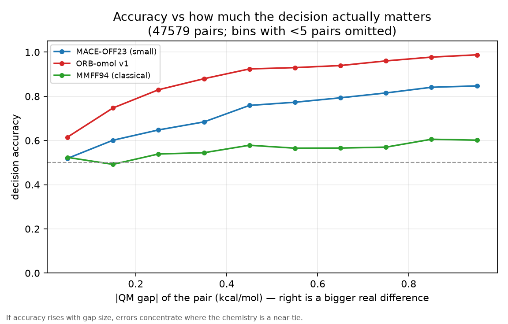

# Do machine-learned potentials preserve the chemical decisions?

[](https://github.com/Qwuantabee/mlip-fidelity/actions/workflows/tests.yml)
[](https://github.com/Qwuantabee/mlip-fidelity/blob/master/LICENSE)
[](https://github.com/Qwuantabee/mlip-fidelity/blob/master/pyproject.toml)

**Three energy models were asked, 16,089 times, which of two near-degenerate conformers is lower in energy (quantum reference gap under 1 kcal/mol). ORB-omol got 90.0% right, MACE-OFF23 76.0% and the classical MMFF94 force field 60.1%; always guessing the same way scores 53.4%. Accuracy falls as a model's pair-gap error rises (median 0.15 / 0.45 / 1.61 kcal/mol), so an energy error only means something next to the gap it has to resolve, not as a leaderboard MAE.**

**The caveat that governs those numbers: ORB-omol and MACE-OFF23 were both trained on the dataset the pairs come from (SPICE), so two of the three figures are in-sample.** On a second dataset with a higher-level reference (Folmsbee, 22,379 pairs) the ordering is the same, 0.833 / 0.773 / 0.622, but that test does not isolate how much of the in-sample figures is memorisation; see [the held-out test](#the-held-out-test-does-any-of-this-survive-outside-the-training-data).


Universal machine-learned interatomic potentials (uMLIPs) are ranked, in every
2026 benchmark, by energy MAE in meV/atom. Nobody downstream of those benchmarks
consumes an energy MAE. A chemist consumes a **decision**: which of these two
conformers is lower, does this reaction go forward, which tautomer wins. Those are
questions about *differences*, at roughly a 1 kcal/mol bar.

That bar is **not** orders of magnitude coarser than a leaderboard number — it is
the same size, because the two are different quantities. 1 kcal/mol is 43 meV per
molecule, which at the median 36 atoms in this set is **1.2 meV/atom**: the same
order as the ~1 meV/atom MAEs these models advertise. The point is not that the
bar is coarser; it is that an average error and a resolution threshold are not
interchangeable, and only one of them tells you whether two candidates swap.

So this repo asks it directly. Take **16,089 conformer pairs** from the SPICE
quantum-chemistry dataset — two geometries of the *same molecule* whose reference
energies differ by **less than 1 kcal/mol** — and ask each model: *which one is
lower?* Score the sign. Compare that to the model's own energy error.

## The result

**Read this table as an in-sample measurement.** Two of the three models trained
on SPICE — MACE-OFF23 on ~95% of v1, ORB-omol via OMol25's documented SPICE2 — so
their rows are fidelity to their own training data, not generalisation. Only
MMFF94 is a clean row.

| model | licence | scored conformers | decided pairs | **decision accuracy** (95% CI) | median \|ΔE\| error | null control p |
|---|---|---|---|---|---|---|
| **ORB-omol v1 (conservative)** | Apache-2.0 | 15,232 | 15,991 | **0.900** (0.895–0.905) | 0.15 kcal/mol | < 0.005 |
| MACE-OFF23 (small) | weights ASL, **non-commercial**; code MIT | 14,913 | 15,717 | **0.760** (0.753–0.766) | 0.45 kcal/mol | < 0.005 |
| MMFF94 (classical force field) | BSD | 14,763 | 15,578 | 0.601 (0.594–0.609) | 1.61 kcal/mol | < 0.005 |

How to read the columns:

- **Ties are excluded, and counted.** A pair whose reference gap is within 0.01
  kcal/mol is a tie and is not scored: 98 pairs for ORB-omol and MACE-OFF23, 97
  for MMFF94. A pair containing a conformer the model could not evaluate is not
  scored either: 0 for ORB-omol, 274 for MACE-OFF23, 414 for MMFF94. "Decided
  pairs" is what is left of the 16,089. A model gap of exactly zero is *not* a
  tie: it is scored as wrong (121 ORB-omol pairs, 82 MACE-OFF23; see Limits).
- **The intervals** are Wilson intervals over pairs. Pairs from one molecule are
  not independent, so for ORB-omol and MACE-OFF23 they are about 1.4x too narrow
  (see Limits). The 1,588 molecules are the independent units.
- **The null-control p** is the floor 200 shuffles can report (1/201), not a
  measured value.
- **Run-to-run noise.** ORB-omol's GPU energies are not bit-reproducible. On the
  held-out set, where it was measured, re-running moved ORB-omol's accuracy by
  0.001 to 0.004 (details in the held-out section); it was not re-measured on
  SPICE. Every gap between models in this table is 0.14 or more, about forty
  times the larger of those figures. MACE-OFF23 flipped no decision across re-runs and MMFF94, on the
  CPU, was bit-identical.
- **Out of sample** the order is unchanged (ORB > MACE > MMFF94) and ORB's lead
  over MACE is 6 points instead of 14; the held-out section says what that does
  and does not show.

All three rows are recomputed from the committed `results/decisions_*.csv` by
`scripts/score.py`, and a model only appears here if
`scripts/verify_completeness.py` confirms its raw artefact covers every one of the
15,232 conformers exactly once.

Four things worth taking from that table.

1. **A small average error is not a resolution guarantee.** MACE-OFF23's median
   error is 0.45 kcal/mol, and the pairs it is being asked about have a median
   true gap of only 0.55 kcal/mol (5th-95th percentile: 0.09-0.95). An error the
   size of the gap means a coin flip on the small ones, which is why it reverses
   24%.

2. **The best model is still wrong one time in ten.** ORB-omol's median error is
   0.15 kcal/mol and 0.900 accuracy means 1,596 wrong orderings out of 15,991. If
   your design loop ranks hundreds of candidates per run, that is a lot of
   swapped pairs.

3. **Accuracy tracks error, and the ordering is unambiguous.** With the classical
   baseline's units corrected (see [the defect trail](docs/DEFECT_TRAIL.md)), the three models are
   monotone in *every* error measure: median gap error 0.15 / 0.45 / 1.61 kcal/mol
   gives accuracy 0.900 / 0.760 / 0.601. Pairwise differences are robust to
   clustering by molecule — on the 15,578 pairs all three models scored, with a
   bootstrap over their 1,530 molecules, ORB−MACE +0.144 [0.135, 0.152] and
   MACE−MMFF +0.160 [0.150, 0.171] (`scripts/intervals.py`) — so this is not a tie. **I do not fit a trend line:** three
   points cannot distinguish a curve from a coincidence, and an earlier draft of
   this README claimed the two were independent, which the corrected units
   refuted.

4. **The biomolecular slice is consistently harder.** Every model drops on
   peptides and solvated amino acids: ORB 0.900 → **0.855**, MACE 0.760 → **0.647**,
   MMFF94 0.601 → 0.552. See
   [`figures/accuracy_by_subset.png`](figures/accuracy_by_subset.png). Part of that
   is composition, not chemistry — see Limits.


### The baseline that makes MMFF's number honest

Pair orientation is arbitrary (whichever conformer happened to be index A), and
the QM gaps are not symmetric: **always guessing "B is higher" scores 0.534** on
these pairs. Against that constant, scored on each model's own pairs (where it
reads 0.534 for all three), the excess over guessing is ORB **+0.366**,
MACE **+0.226**, and MMFF **+0.067**.

MMFF94's edge is small but not noise: it beats the constant predictor on 4,125
pairs and loses on 3,079 (McNemar-style sign test p ≈ 6e-35). So the classical
force field does carry real signal on sub-kcal orderings — it just carries an
order of magnitude less of it than either ML potential. The earlier version of
this paragraph said "barely above a coin flip" against its pre-fix 0.563; that was
both a stale number and the wrong conclusion, and I am correcting it rather than
quietly deleting it.

## The held-out test: does any of this survive outside the training data?

A reviewer established that two of the three models train on the data I scored
them on — MACE-OFF23 on ~95% of SPICE v1, ORB-omol's OMol25 documenting SPICE2.
So the table above measures **fidelity to their own training data**. Only MMFF94
was ever a clean row.

So I scored all three on two sets from outside SPICE. "Held out" here means a
different dataset: whether individual Folmsbee or MPCONF196 molecules also occur
in SPICE or in OMol25 was not checked. Both are compared on the slice where they
overlap with SPICE: reference gaps under 1 kcal/mol.

**What this test can and cannot say, up front.** It shows the ranking of the
three models survives a change of dataset and of reference method. It does *not*
separate training-set contamination from difficulty. The only uncontaminated
model, MMFF94, is used as the difficulty control, and it is a poor one: its
accuracy barely depends on the size of the gap, while both ML models' accuracy
depends on it steeply, and Folmsbee's pairs are much closer to ties (median
reference gap 0.24 kcal/mol against SPICE's 0.55). At equal gap size all three
models, ORB-omol included, score *higher* on Folmsbee than on SPICE. No
inflation from contamination is demonstrated for either ML model.

| benchmark | compounds | sub-kcal pairs | reference |
|---|---|---|---|
| **Folmsbee & Hutchison 2021** | 690 | **22,379** | DLPNO-CCSD(T) |
| MPCONF196 (Řezáč 2018) | 7 | 30 | PNO-LCCSD(T)-F12 |

### The result, and a correction


*Left: accuracy on each dataset. Right: accuracy by size of the reference gap,
SPICE dashed and Folmsbee solid (the gap-size table below). An earlier version
of the right panel plotted the withdrawn "shift beyond MMFF94" bars.*

| model | SPICE (in-sample) | **Folmsbee held out** | shift | shift minus MMFF94's | Folmsbee, ties excluded (decided pairs) |
|---|---|---|---|---|---|
| ORB-omol v1 | 0.900 | **0.833** (0.828–0.837) | −0.068 | −0.089 | 0.840 (21,812) |
| MACE-OFF23 | 0.760 | **0.773** (0.768–0.779) | +0.013 | −0.008 | 0.780 (21,812) |
| MMFF94 | 0.601 | **0.622** (0.616–0.629) | +0.021 | — (control) | 0.624 (21,377) |

The bold column scores every sub-kcal Folmsbee pair, near-ties included, while
the SPICE column excludes ties, so the "shift" columns mix two definitions. The
last column is the like-for-like figure (567 ties excluded for the ML models, 553
for MMFF94); on that basis the shifts are −0.060 / +0.020 / +0.023. The "shift
minus MMFF94's" column is a difference of raw shifts, not a measured
contamination effect: see the gap-size table below before quoting it.

**Correction (review R2, 2026-11-16).** The first version of this table ran the
74 charged Folmsbee compounds (1,943 of the 22,379 pairs; +1: 60, −1: 10, +2: 4)
as neutral singlets: the builder hard-coded charge 0 although the dataset lists
each ion's charge in `geometries/CHG-charges.txt`. With the true charges ORB-omol,
which takes the charge as input, goes from 0.668 to 0.794 on those compounds'
1,887 decided pairs and from 0.823 to 0.833 overall, a step that includes the
run-to-run noise measured below; MMFF94 can now perceive
bonds for most of the ions and scores 21,930 pairs instead of 20,169 (0.625 →
0.622); MACE-OFF23 takes no charge input and is unchanged. No compound had to be
excluded for want of a charge.

**Run-to-run noise, measured** (`scripts/orb_repeatability.py` →
`results/orb_repeatability.json`). ML potential energies are not
bit-reproducible on the GPU. Re-running each model three times
on the same 607 conformers (63 seeded-random compounds, 2,217 pairs), in fresh
processes with a byte-identical input, moved all 607 of ORB-omol's energies
(largest |ΔE| 0.021 kcal/mol, median 0.0035), flipped up to 16 decisions between
two runs (0.72%) and spread its sample accuracy over 0.836–0.839 (0.0036).
MACE-OFF23 moved 41 energies by at most 1.7e-09 kcal/mol and flipped none;
MMFF94, the CPU control, was bit-identical, so the noise is the models', not the
harness's. On the full set the two committed ORB-omol runs saw identical neutral
inputs and disagree on 187 of those 20,436 decisions (0.92%; largest gap change
0.040 kcal/mol): a net 27 decisions, 0.0012 of the 22,379-pair accuracy, which is
why a predicted 0.834 came out 0.833. **So ORB-omol's 0.833 carries an error bar
of about ±0.0012** (one pair of full-set runs, so itself an estimate; the
three-run sample above spread 0.0036 on a tenth of the pairs). The 0.823 → 0.833 step (+0.0095, 7.9× that) survives it: it
is +0.0107 from the charged pairs, whose inputs changed (a net 240 decisions,
where noise could move at most 19), less 0.0012 of noise on the neutral ones.

The intervals in the table are Wilson intervals, which treat the ~32 pairs per
compound as independent. They are not: resampling whole compounds (cluster
bootstrap, 10,000 draws, `scripts/intervals.py`) widens them to ORB [0.823, 0.842], MACE [0.762, 0.784]
and MMFF94 [0.607, 0.637], a design effect of 3.5–5.4. The Folmsbee column also
counts every sub-kcal pair, including 567 near-ties (|gap| ≤ 0.01 kcal/mol; 553
for MMFF94) that the SPICE column excludes; with ties excluded the held-out
figures are 0.840 / 0.780 / 0.624.

#### Accuracy at equal gap size

Decision accuracy by size of the reference gap, SPICE (in-sample) against
Folmsbee, from `scripts/reconcile_heldout.py` (block H3; ties included in the
first bin):

| reference gap (kcal/mol) | ORB-omol SPICE → Folmsbee | MACE-OFF23 SPICE → Folmsbee | MMFF94 SPICE → Folmsbee |
|---|---|---|---|
| 0 – 0.1 | 0.595 → 0.623 | 0.533 → 0.595 | 0.513 → 0.537 |
| 0.1 – 0.25 | 0.764 → 0.821 | 0.623 → 0.769 | 0.515 → 0.606 |
| 0.25 – 0.5 | 0.894 → 0.924 | 0.733 → 0.843 | 0.595 → 0.661 |
| 0.5 – 0.75 | 0.938 → 0.963 | 0.800 → 0.888 | 0.613 → 0.699 |
| 0.75 – 1.0 | 0.980 → 0.983 | 0.845 → 0.902 | 0.648 → 0.677 |

Every model is more accurate on Folmsbee in every bin. ORB-omol's lower overall
figure (0.833 against 0.900) is therefore a composition effect: 5,488 of
Folmsbee's 22,379 pairs (24.5%) have a gap under 0.1 kcal/mol, against 922 of
SPICE's 16,089 (5.7%), and those are the pairs every model gets wrong most
often. Reweighting Folmsbee's five bins to SPICE's gap distribution (ties
excluded on both sides, as in the SPICE table) gives ORB-omol 0.924, MACE-OFF23
0.851 and MMFF94 0.663, which is +0.024 / +0.091 / +0.062 against their SPICE
figures; `tests/test_readme_secondary_claims.py` recomputes it. Why Folmsbee is easier at equal gap is not
established; it differs from SPICE in at least three ways at once (relaxed minima
instead of MD snapshots, a DLPNO-CCSD(T) reference instead of the DFT level the
models were fitted near, and no ion pairs or dipeptides).

#### The MMFF94-offset estimate, and why it is not a contamination measurement

MMFF94 has never seen either dataset, so one can take its +0.021 as an estimate
of how much easier the held-out slice is, and subtract it from each ML model's
raw shift. That treats slice difficulty as the same for every model, which the
gap-size table shows is false. Intervals resample SPICE molecules and Folmsbee
compounds independently of each other, one draw shared by all three models
(10,000 draws, `scripts/intervals.py`).

- **ORB-omol: −0.089** (95% CI −0.107 to −0.070) on that estimate. An earlier
  version of this README read it as "ORB-omol loses about 9 points beyond
  difficulty, consistent with in-sample inflation". That reading is withdrawn:
  the interval covers sampling error only, and the sign of the effect reverses
  once gap size is matched (+0.024 on its own, −0.038 relative to MMFF94's
  gap-matched +0.062). The data are consistent with some inflation and with none.
- **MACE-OFF23: −0.008** (95% CI −0.028 to +0.012); gap-matched it is +0.091.
  No inflation detected, which is absence of evidence, not evidence of absence.

The offset is the weak link for both models, for the same reasons: Folmsbee's
sub-kcal pairs sit much closer to ties than SPICE's, ML accuracy rises steeply
with the gap while MMFF94's is nearly flat, MMFF94 scores a different pair set,
and the reference level changes from DFT (ωB97M-D3(BJ) for SPICE and for
MACE-OFF23's training labels) to DLPNO-CCSD(T). Matching on gap size, an
equally defensible specification, moves both figures by more than their
intervals (ORB-omol −0.089 → −0.038, MACE-OFF23 −0.008 → +0.029, each relative
to MMFF94), so neither is identified. An
experiment that could identify it needs the same molecules scored by a model
before and after they enter its training set, which this repo does not have.

**The MPCONF196 result I published earlier is withdrawn.** I reported that
MACE's sub-kcal accuracy "collapses out of sample, 0.760 → 0.467, p = 0.0008."
That p-value was computed over 30 pairs as if they were 30 independent
observations. They are not: the 30 pairs come from **7 compounds, 26 of them from
3 compounds** (FGG114 10, GGF01 9, GFA01 7). A cluster bootstrap over compounds gives a 95% interval of
[0.14, 0.71] — consistent with almost anything. At n = 30 that benchmark cannot
distinguish a real drop from noise, and the well-powered set contradicts it. The
number is kept here, labelled, so it cannot be misquoted again.

Why the two differ is not fully resolved, but an earlier version of this
paragraph called those three compounds macrocycles, and they are not: their
formulas (C13H17N3O4, C13H17N3O4, C14H19N3O4) are those of linear tripeptides (a
cyclic one would have lost another H2O; I checked formulas, not geometries). That
points to composition rather than size. MACE-OFF23's own in-sample accuracy on
SPICE dipeptides is 0.648 (6,510 pairs), its weakest large subset, so these 30
pairs probe its known peptide weakness. MPCONF196 as a whole is larger (median 32
heavy atoms, 15 conformers larger than anything in Folmsbee, whose median is 22),
but a size effect is not needed to explain these 30 pairs.

### What this leaves standing

On 22,379 sub-kcal pairs from a dataset outside SPICE, **ORB-omol still orders near-degenerate conformers at 0.833 against MMFF94's
0.622** — an ML potential does beat a force field outside SPICE, by about 21
points on Folmsbee's own mix of gap sizes against 30 in-sample. Most of that
difference is the gap mix rather than the dataset: at SPICE's gap distribution
the Folmsbee margin is 26 points. That the ranking ORB > MACE > MMFF94 holds on
both datasets is the defensible claim. How much of either ML model's in-sample
accuracy is memorisation is not measured here.

## Why the null control matters

Every accuracy above is checked against the answer-leaking failure mode: shuffle
which model gap is paired with which quantum gap, 200 times, and rescore. If the
pipeline were leaking, shuffled pairs would score as well as real ones. Shuffled
accuracy collapses to 0.498–0.502 for every model, and no shuffle reached the
real accuracy in any of the six rows: p < 0.005, where 1/201 ≈ 0.005 is the
smallest p-value 200 shuffles can report — a floor, not a measurement. What the
shuffle shows is that the labels carry signal and the pipeline does not leak the
answer. It does not by itself make 0.900 right; the raw-energy recomputation in
`scripts/check_artefacts.py` and the held-out test carry more of that weight.

## Where the failures live

Accuracy rises with the size of the true gap: near-ties are close to coin flips
and clear preferences are mostly right. That shape is what a model resolving
*some* chemistry looks like, as opposed to one that is guessing:



Every pair, plotted. A point on the wrong side of zero is a reversed decision.
The triangles pinned to the frame edges are points whose model gap exceeded the
plotted range — counted rather than hidden:


## How the data is built

- **Reference:** [SPICE 1.1.4](https://zenodo.org/records/8222043)
  (ωB97M-D3(BJ)/def2-TZVPPD), 19,238 molecules. Downloaded and byte-verified against its
  Content-Length (16,058,156,944 bytes).
- **Pairs:** every conformer pair of a molecule whose QM energies differ by under
  1 kcal/mol, capped per molecule and selected deterministically from a seed:
  **16,089 pairs from 1,588 molecules**, 6,607 of them biomolecular (6,579
  dipeptides). Each model is scored on the pairs it can actually evaluate.
- **Charges:** 404 molecules are ions. Formal charge and spin multiplicity are
  parsed from each molecule's SMILES rather than assumed neutral — running an
  anion as a closed-shell neutral returns a finite number for the wrong
  electronic state.
- **Scoring:** every comparison is on the **difference** `E(B) − E(A)` within one
  molecule, never absolute energies. Models use different reference zeros (ORB and
  MACE both sit near −28,000 eV on these molecules), so only differences are
  transferable.

## Reproducing it

The two `--max-*-per-molecule 12` flags are **not optional**: they are the values
the committed manifest was built with, and a reviewer found that omitting them
yields 12,242 pairs instead of 16,089 while every later step silently succeeds.

```bash
python scripts/par_fetch.py <zenodo-url> SPICE-1.1.4.hdf5   # 16 GB, resumable
python scripts/spice_inventory.py --archive SPICE-1.1.4.hdf5
python scripts/build_pairs.py --archive SPICE-1.1.4.hdf5 --max-per-subset 300 \
    --max-pairs-per-molecule 12 --max-conformers-per-molecule 12
bash scripts/sweep_all.sh                                   # one launcher, one GPU
python scripts/verify_completeness.py --write               # gate: artefact coverage
python scripts/score.py --require-complete
python scripts/make_figures.py
pytest tests/
```

Each model runs in **its own virtualenv** (`envs/<model>/`), not out of taste:
installing `fairchem-core` upgrades `e3nn` to 0.6, which silently breaks MACE
checkpoint loading (`ValueError: too many values to unpack`) *at evaluation time*,
not at import. A shared environment produces wrong numbers, quietly.

**The held-out half** needs two small public repositories (no download over a
few MB) and the same model venvs:

```bash
git clone https://github.com/ghutchis/conformer-benchmark _data/folmsbee     # Folmsbee & Hutchison 2021, MIT; built at commit 0109c8e
git clone https://github.com/grimme-lab/benchmark-MPCONF196 _data/mpconf196  # Řezáč 2018, references revised 2023; built at commit e1d030d
python scripts/build_heldout_folmsbee.py     # -> results/heldout_folmsbee.json (22,379 pairs)
python scripts/build_heldout.py              # -> results/heldout_mpconf196.json
python scripts/score_heldout.py --bench results/heldout_folmsbee.json --tag heldout_folmsbee   # GPU
python scripts/score_heldout.py              # MPCONF196, GPU
python scripts/orb_repeatability.py --publish   # GPU, a few minutes
python scripts/reconcile_heldout.py          # clustered intervals, accuracy by gap size
python scripts/intervals.py                  # every bootstrap interval in this README
```

Without a GPU, `score_heldout.py ... --tag heldout_folmsbee --from-raw` followed by
`orb_repeatability.py --from-saved --publish` re-derives every Folmsbee artefact
from the committed energies; both builders and that pair of commands reproduce
the committed files byte for byte.

**Expected runtime:** the 16 GB SPICE download dominates (hours on one
connection). The three SPICE model runs took 433 s (ORB-omol), 319 s (MACE-OFF23)
and 18 s (MMFF94) on one GPU (`wall_seconds` in `results/raw_*.json`). The
held-out builders take about 15 s, every no-GPU recompute under 20 s, and
`pytest` about 20 s.

## What went wrong on the way (kept on purpose)

Six defects changed or withdrew a published number or broke a guard on one.
Regression tests for them are in `tests/`. Full account: [`docs/DEFECT_TRAIL.md`](docs/DEFECT_TRAIL.md).

| defect | effect on the published number |
|---|---|
| SPICE coordinates are Bohr, were read as Ångström | MACE-OFF23 scored at chance, 0.489; 0.723 once converted |
| ORB-omol row scored from a 1,500-conformer artefact | 0.893 withdrawn; full re-run gives 0.900 on 15,991 pairs |
| Chunk cache keyed by index, not by slice | merged artefacts had 1,200 duplicated and 6,232 missing conformers |
| Failure counts summed from truncated lists | a run with 319 failed conformers reported 70 |
| MMFF94 energies stored as eV, are kcal/mol | MMFF94 error inflated 23x; an "error does not predict accuracy" headline was refuted and removed |
| Completeness gate was a hand-edited file | now recomputed from raw artefacts; scoring refuses partial sweeps |

## Limits, stated plainly

Each limit below is set out with its measurement in [`docs/LIMITS.md`](docs/LIMITS.md).

- **Two of the three rows are in-sample.** MACE-OFF23 trained on ~95% of SPICE v1
  and ORB-omol's OMol25 includes SPICE2; MMFF94 is the only clean out-of-sample
  row. The held-out test shows the ranking survives outside SPICE; it does not
  measure how large the in-sample inflation is.
- **The reference is DFT (ωB97M-D3(BJ)), not CCSD(T).** A wrong decision within
  ~0.2 kcal/mol is indistinguishable from reference noise.
- **Not every pair is a conformer pair:** 3,149 of 16,089 pairs (19.6%) come from
  DES370K dimers and 21 ion-pair diatomics. On the ion pairs both ML models return exact-zero gaps, a cutoff
  effect, and ORB scores 0.126.
- **The geometries are MD snapshots, not relaxed minima**, and the "biomolecular"
  slice is 99.6% dipeptides.
- **Pairs cluster by molecule and the intervals do not account for it.** The design
  effect is about 2 (ICC about 0.10), so the ORB and MACE intervals should be about
  1.4x wider than quoted (`scripts/intervals.py`). The held-out Wilson intervals are worse off (design
  effect 3.5–5.4); compound-clustered intervals are given beside that table. No conclusion changes — the model differences are far
  larger than that — but the CIs as printed are optimistic.
- **MACE-OFF23 has no charge input**: 3,241 of its 15,717 decided pairs involve a
  charged conformer, and it scores **0.623 there against 0.796 on neutral pairs**.
  Scored only on its own training domain it reads 0.796 on 12,476 pairs. It
  returns NaN on 319 conformers whose elements it does not support.
- **A conformer pair is a proxy for a chemical decision**, not a reaction energy,
  a binding affinity or a barrier; three models are not a model zoo.
- **No commercial claim.** MACE-OFF23's weights are non-commercial (Academic
  Software Licence); see [`NOTICE`](NOTICE).

## Layout

```
src/mlipfid/decisions.py       decision pairs, Wilson intervals, null control
src/mlipfid/spice.py           SPICE reader (Bohr -> Angstrom, charges, subsets)
src/mlipfid/select.py          energy-stratified conformer selection
scripts/run_model.py           one model, one subprocess, JSON out
scripts/run_sweep.py           chunked, resumable, per-model venv dispatch, locked
scripts/verify_completeness.py recomputes which models cover every conformer
scripts/score.py               sign agreement, error stats, null control
scripts/make_figures.py        seven figures, every number read from a CSV
scripts/reconcile_heldout.py   held-out checks: clustered intervals, accuracy by gap size
docs/DEFECT_TRAIL.md           the wrong numbers found on the way, and their fixes
docs/LIMITS.md                 every limit, with its measurement
tests/                         tests: units, sign convention, null, layout, cache
```

MIT licence for this repository's own code. The models and data keep their own
terms: see [`NOTICE`](NOTICE) for each model and dataset, and the licence figure
above.

## References

- **SPICE** — Eastman et al., *SPICE, A Dataset of Drug-like Molecules and Peptides
  for Training Machine Learning Potentials*, Sci. Data 10, 11 (2023).
  doi:10.1038/s41597-022-01882-6. Level of theory ωB97M-D3(BJ)/def2-TZVPPD.
- **MACE-OFF23** — Kovács et al., arXiv:2312.15211. Trained on ~95% of SPICE v1
  (neutral, ten elements, no ion pairs), which is why its row is in-sample here.
- **OMol25** — arXiv:2505.08762. ORB-omol's training set; its documented community
  domain includes SPICE2, a superset of SPICE 1.x.
- **RDKit MMFF94** — Halgren, *J. Comput. Chem.* 17, 490 (1996), via RDKit
  2026.09.2. Note `CalcEnergy()` returns kcal/mol.
- **Prior art on decision-vs-average-error framing** — Matbench Discovery
  (Riebesell et al.) makes the "a low MAE does not mean the model is useful"
  argument for materials; conformer-ranking benchmarks (Folmsbee, MPCONF196,
  TorsionNet206) exist for the molecular case. **This repo's contribution is not the
  framing; it is the measurement on SPICE conformer pairs, and the disclosure that
  two of its three models are trained on the test data.**

## Part of a set

Six repos, one method: take the number a field reports, measure what a practitioner uses, publish
the gap.

- [admet-split-truth](https://github.com/Qwuantabee/admet-split-truth): does a validation split predict error on the next compounds?
- mlip-fidelity: do ML potentials rank near-degenerate conformers correctly?
- [epistasis-ceiling](https://github.com/Qwuantabee/epistasis-ceiling): do single-mutant effects add up on a double mutant?
- [variant-effect-prediction](https://github.com/Qwuantabee/variant-effect-prediction): does a cleaner assay target help zero-shot ESM-2?
- [single-cell-de](https://github.com/Qwuantabee/single-cell-de): are cells replicates?
- [enzyme-kinetics](https://github.com/Qwuantabee/enzyme-kinetics): how wrong is a Lineweaver-Burk Km?

Overview: https://github.com/Qwuantabee
