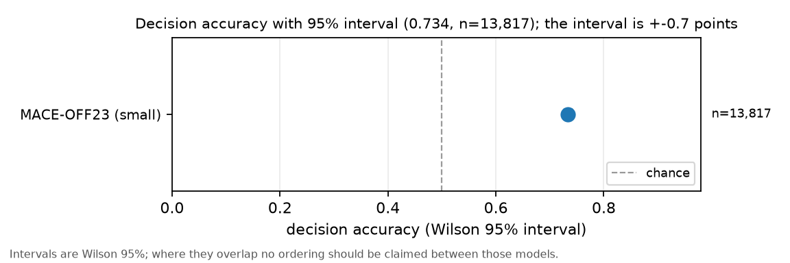

# Do machine-learned potentials preserve the chemical decisions?

**On sub-kcal/mol conformer pairs, sign accuracy is a steep and predictable function of pair-gap error: a median error of 0.15 kcal/mol gets 90% of orderings right, 0.45 gets 76%, and 1.61 gets 60%. Error does predict the decision — but only if you compare it to the gap you are trying to resolve, not to a leaderboard MAE.**


Universal machine-learned interatomic potentials (uMLIPs) are ranked, in every
2026 benchmark, by energy MAE in meV/atom. Nobody downstream of those benchmarks
consumes an energy MAE. A chemist consumes a **decision**: which of these two
conformers is lower, does this reaction go forward, which tautomer wins. Those are
questions about *differences*, at roughly a 1 kcal/mol bar.

That bar is **not** orders of magnitude coarser than a leaderboard number — it is
the same size, because the two are different quantities. 1 kcal/mol is 43 meV per
molecule, which at the median 36 atoms in this set is **1.2 meV/atom**: the same
order as the ~1 meV/atom MAEs these models advertise. The point is not that the
bar is coarser; it is that an average error and a resolution threshold are not
interchangeable, and only one of them tells you whether two candidates swap.

So this repo asks it directly. Take **16,089 conformer pairs** from the SPICE
quantum-chemistry dataset — two geometries of the *same molecule* whose reference
energies differ by **less than 1 kcal/mol** — and ask each model: *which one is
lower?* Score the sign. Compare that to the model's own energy error.

## The result

| model | licence | scored conformers | decided pairs | **decision accuracy** (95% CI) | median \|ΔE\| error | null control p |
|---|---|---|---|---|---|---|
| **ORB-omol v1 (conservative)** | Apache-2.0 | 15,232 | 15,991 | **0.900** (0.895–0.905) | 0.15 kcal/mol | < 0.005 |
| MACE-OFF23 (small) | weights ASL, **non-commercial**; code MIT | 14,913 | 15,717 | **0.760** (0.753–0.766) | 0.45 kcal/mol | < 0.005 |
| MMFF94 (classical force field) | BSD | 14,763 | 15,578 | 0.601 (0.594–0.609) | 1.61 kcal/mol | < 0.005 |

**Read this table as an in-sample measurement.** Two of the three models trained
on SPICE — MACE-OFF23 on ~95% of v1, ORB-omol via OMol25's documented SPICE2 — so
these numbers are fidelity to their own training data, not generalisation. The
held-out test further down is where generalisation is measured: out of sample the
order is unchanged (ORB > MACE > MMFF94), but ORB's lead over MACE shrinks from 14
to 6 points. Only MMFF94 was ever a clean row. The intervals are Wilson intervals
(about 1.4x too narrow once pairs are clustered by molecule, see Limits), and the
null-control p is the floor 200 shuffles can report (1/201), not a measured value.

All three rows are recomputed from the committed `results/decisions_*.csv` by
`scripts/score.py`, and a model only appears here if
`scripts/verify_completeness.py` confirms its raw artefact covers every one of the
15,232 conformers exactly once.

Four things worth taking from that table.

1. **A small average error is not a resolution guarantee.** MACE-OFF23's median
   error is 0.45 kcal/mol, and the pairs it is being asked about have a median
   true gap of only 0.55 kcal/mol (5th-95th percentile: 0.09-0.95). An error the
   size of the gap means a coin flip on the small ones, which is why it reverses
   25%.

2. **The best model is still wrong one time in ten.** ORB-omol's median error is
   0.15 kcal/mol and 0.900 accuracy means 1,596 wrong orderings out of 15,991. If
   your design loop ranks hundreds of candidates per run, that is a lot of
   swapped pairs.

3. **Accuracy tracks error, and the ordering is unambiguous.** With the classical
   baseline's units corrected (see "What went wrong"), the three models are
   monotone in *every* error measure: median gap error 0.15 / 0.45 / 1.61 kcal/mol
   gives accuracy 0.900 / 0.760 / 0.601. Pairwise differences are robust to
   clustering by molecule — on the 15,578 pairs all three models scored, with a
   bootstrap over their 1,530 molecules, ORB−MACE +0.144 [0.135, 0.152] and
   MACE−MMFF +0.161 [0.150, 0.171] — so this is not a tie. **I do not fit a trend line:** three
   points cannot distinguish a curve from a coincidence, and an earlier draft of
   this README claimed the two were independent, which the corrected units
   refuted.

4. **The biomolecular slice is consistently harder.** Every model drops on
   peptides and solvated amino acids: ORB 0.900 → **0.855**, MACE 0.760 → **0.647**,
   MMFF94 0.601 → 0.552. See
   [`figures/accuracy_by_subset.png`](figures/accuracy_by_subset.png). Part of that
   is composition, not chemistry — see Limits.



### The baseline that makes MMFF's number honest

Pair orientation is arbitrary (whichever conformer happened to be index A), and
the QM gaps are not symmetric: **always guessing "B is higher" scores 0.534** on
these pairs. Against that constant, scored on each model's own pairs (where it
reads 0.534 for all three), the excess over guessing is ORB **+0.366**,
MACE **+0.226**, and MMFF **+0.067**.

MMFF94's edge is small but not noise: it beats the constant predictor on 4,125
pairs and loses on 3,079 (McNemar-style sign test p ≈ 6e-35). So the classical
force field does carry real signal on sub-kcal orderings — it just carries an
order of magnitude less of it than either ML potential. The earlier version of
this paragraph said "barely above a coin flip" against its pre-fix 0.563; that was
both a stale number and the wrong conclusion, and I am correcting it rather than
quietly deleting it.

## The held-out test: does any of this survive outside the training data?

A reviewer established that two of the three models train on the data I scored
them on — MACE-OFF23 on ~95% of SPICE v1, ORB-omol's OMol25 documenting SPICE2.
So the table above measures **fidelity to their own training data**. Only MMFF94
was ever a clean row.

So I scored all three on two genuinely held-out sets. Both are compared on the
slice where they overlap with SPICE: reference gaps under 1 kcal/mol.

| benchmark | compounds | sub-kcal pairs | reference |
|---|---|---|---|
| **Folmsbee & Hutchison 2021** | 690 | **22,379** | DLPNO-CCSD(T) |
| MPCONF196 (Řezáč 2018) | 7 | 30 | PNO-LCCSD(T)-F12 |

### The result, and a correction


| model | SPICE (in-sample) | **Folmsbee held out** | shift | beyond difficulty |
|---|---|---|---|---|
| ORB-omol v1 | 0.900 | **0.833** (0.828–0.837) | −0.068 | **−0.089** |
| MACE-OFF23 | 0.760 | **0.773** (0.768–0.779) | +0.013 | **−0.008** |
| MMFF94 | 0.601 | **0.622** (0.616–0.629) | +0.021 | — (control) |

**Correction (review R2, 2026-11-16).** The first version of this table ran the
74 charged Folmsbee compounds (1,943 of the 22,379 pairs; +1: 60, −1: 10, +2: 4)
as neutral singlets: the builder hard-coded charge 0 although the dataset lists
each ion's charge in `geometries/CHG-charges.txt`. With the true charges ORB-omol,
which takes the charge as input, goes from 0.668 to 0.794 on those compounds'
1,887 decided pairs and from 0.823 to 0.833 overall; MMFF94 can now perceive
bonds for most of the ions and scores 21,930 pairs instead of 20,169 (0.625 →
0.622); MACE-OFF23 takes no charge input and is unchanged. No compound had to be
excluded for want of a charge. ORB's energies are not bit-reproducible on the
GPU: re-running the unchanged neutral compounds moved 187 of their 20,436 pair
decisions (largest gap change 0.04 kcal/mol), which is why the overall figure is
0.833 rather than the 0.834 a charged-only re-run predicted.

The intervals in the table are Wilson intervals, which treat the ~32 pairs per
compound as independent. They are not: resampling whole compounds (cluster
bootstrap, 4,000 draws) widens them to ORB [0.823, 0.841], MACE [0.761, 0.784]
and MMFF94 [0.607, 0.637], a design effect of 3.4–5.2. The Folmsbee column also
counts every sub-kcal pair, including 567 near-ties (|gap| ≤ 0.01 kcal/mol; 553
for MMFF94) that the SPICE column excludes; with ties excluded the held-out
figures are 0.840 / 0.780 / 0.624.

MMFF94 has never seen either dataset, so I use its +0.021 as an estimate of how
much easier this held-out slice is, and subtract it. That is an assumption, not a
measurement: it treats slice difficulty as the same for every model. Intervals
below resample SPICE molecules and Folmsbee compounds independently (4,000 draws).

- **ORB-omol loses about 9 points beyond difficulty** (−0.089, 95% CI −0.107 to
  −0.070) — consistent with in-sample inflation and with OMol25's documented
  inclusion of SPICE2.
- **MACE-OFF23: no inflation detected** (−0.008, 95% CI −0.027 to +0.012). That
  is absence of evidence, not evidence of absence: with a standard error of
  0.010 this design can only detect an inflation larger than about 0.03 at 80%
  power.

The difficulty offset is the weak link. Folmsbee's sub-kcal pairs sit much closer
to ties than SPICE's, ML accuracy rises steeply with the gap while MMFF94's is
nearly flat, MMFF94 scores a different pair set, and the reference level changes
from ωB97M-D3(BJ) (MACE-OFF23's training level) to DLPNO-CCSD(T). A reviewer
showed that equally defensible re-specifications (gap-matched, or restricted to
MACE-OFF23's own training domain) push MACE-OFF23's figure to either side of
zero, so its size is not identified.

The gap bins cannot separate the two either. In the 0.1–0.25 kcal/mol bin MACE
scores 0.769 on Folmsbee against 0.623 on SPICE — but MMFF94, which trained on
neither set, also scores higher on Folmsbee in every bin (0.606 vs 0.515 in the
same one).

**The MPCONF196 result I published earlier is withdrawn.** I reported that
MACE's sub-kcal accuracy "collapses out of sample, 0.760 → 0.467, p = 0.0008."
That p-value was computed over 30 pairs as if they were 30 independent
observations. They are not: the 30 pairs come from **7 compounds, 26 of them from
3 compounds** (FGG114 10, GGF01 9, GFA01 7). A cluster bootstrap over compounds gives a 95% interval of
[0.14, 0.71] — consistent with almost anything. At n = 30 that benchmark cannot
distinguish a real drop from noise, and the well-powered set contradicts it. The
number is kept here, labelled, so it cannot be misquoted again.

Why the two differ is not fully resolved, but an earlier version of this
paragraph called those three compounds macrocycles, and they are not: their
formulas (C13H17N3O4, C13H17N3O4, C14H19N3O4) are those of linear tripeptides (a
cyclic one would have lost another H2O; I checked formulas, not geometries). That
points to composition rather than size. MACE-OFF23's own in-sample accuracy on
SPICE dipeptides is 0.648 (6,510 pairs), its weakest large subset, so these 30
pairs probe its known peptide weakness. MPCONF196 as a whole is larger (median 32
heavy atoms, 15 conformers larger than anything in Folmsbee, whose median is 22),
but a size effect is not needed to explain these 30 pairs.

### What this leaves standing

On 22,379 genuinely unseen sub-kcal pairs, **ORB-omol still orders near-degenerate
conformers at 0.833 against MMFF94's 0.622** — an ML potential does beat a force
field out of sample, just by about 21 points rather than the 30 the in-sample
table implied. That is the defensible claim.

## Why the null control matters

Every accuracy above is checked against the answer-leaking failure mode: shuffle
which model gap is paired with which quantum gap, 200 times, and rescore. If the
pipeline were leaking, shuffled pairs would score as well as real ones. Shuffled
accuracy collapses to 0.498–0.502 for every model, and no shuffle reached the
real accuracy in any of the six rows: p < 0.005, where 1/201 ≈ 0.005 is the
smallest p-value 200 shuffles can report — a floor, not a measurement. What the
shuffle shows is that the labels carry signal and the pipeline does not leak the
answer. It does not by itself make 0.900 right; the raw-energy recomputation in
`scripts/check_artefacts.py` and the held-out test carry more of that weight.

## Where the failures live

Accuracy rises with the size of the true gap: near-ties are close to coin flips
and clear preferences are mostly right. That shape is what a model resolving
*some* chemistry looks like, as opposed to one that is guessing:


Every pair, plotted. A point on the wrong side of zero is a reversed decision.
The triangles pinned to the frame edges are points whose model gap exceeded the
plotted range — counted rather than hidden:


## How the data is built

- **Reference:** [SPICE 1.1.4](https://zenodo.org/records/8222043)
  (ωB97M-D3(BJ)/def2-TZVPPD), 19,238 molecules. Downloaded and byte-verified against its
  Content-Length (16,058,156,944 bytes).
- **Pairs:** every conformer pair of a molecule whose QM energies differ by under
  1 kcal/mol, capped per molecule and selected deterministically from a seed:
  **16,089 pairs from 1,588 molecules**, 6,607 of them biomolecular (6,579
  dipeptides). Each model is scored on the pairs it can actually evaluate.
- **Charges:** 404 molecules are ions. Formal charge and spin multiplicity are
  parsed from each molecule's SMILES rather than assumed neutral — running an
  anion as a closed-shell neutral returns a finite number for the wrong
  electronic state.
- **Scoring:** every comparison is on the **difference** `E(B) − E(A)` within one
  molecule, never absolute energies. Models use different reference zeros (ORB and
  MACE both sit near −28,000 eV on these molecules), so only differences are
  transferable.

## Reproducing it

The two `--max-*-per-molecule 12` flags are **not optional**: they are the values
the committed manifest was built with, and a reviewer found that omitting them
yields 12,242 pairs instead of 16,089 while every later step silently succeeds.

```bash
python scripts/par_fetch.py <zenodo-url> SPICE-1.1.4.hdf5   # 16 GB, resumable
python scripts/spice_inventory.py --archive SPICE-1.1.4.hdf5
python scripts/build_pairs.py --archive SPICE-1.1.4.hdf5 --max-per-subset 300 \
    --max-pairs-per-molecule 12 --max-conformers-per-molecule 12
bash scripts/sweep_all.sh                                   # one launcher, one GPU
python scripts/verify_completeness.py --write               # gate: artefact coverage
python scripts/score.py --require-complete
python scripts/make_figures.py
pytest tests/
```

Each model runs in **its own virtualenv** (`envs/<model>/`), not out of taste:
installing `fairchem-core` upgrades `e3nn` to 0.6, which silently breaks MACE
checkpoint loading (`ValueError: too many values to unpack`) *at evaluation time*,
not at import. A shared environment produces wrong numbers, quietly.

## What went wrong on the way (kept on purpose)

This section exists because a repo that only shows its successes teaches the
reader nothing about how far to trust it.

**1. A unit bug that made the first result meaningless.** The first full sweep said
MACE ranked sub-kcal pairs at chance: accuracy 0.489, null p = 0.58. The pipeline
was wrong, not the model — **SPICE stores conformations in Bohr**, and they were
being handed to ASE as Ångström, stretching every molecule by 1.89×. With the
conversion applied and nothing else changed, accuracy went 0.489 → 0.723.

**2. A withdrawn number.** An earlier revision of this README reported ORB-omol v1
at 0.893. That row had been scored from an artefact holding 1,500 conformers
while claiming 9,409 decided pairs. It was withdrawn rather than patched, and has
now been re-measured in full: the complete sweep gives **0.900 on 15,991 decided
pairs**, from an artefact that covers all 15,232 conformers. The pre-fix number
and the post-fix number are close, which is luck, not vindication — the first one
was not reproducible and should never have been published.

**3. A chunk cache that silently corrupted every result.** Chunk files were named
by chunk *index*. Two sweeps with different `--chunk` sizes — one launched by a
stale wrapper script that bypassed the shell-level lock — wrote into the same
slots, so a 600-conformer chunk was resumed as if it were a 1,500-conformer slice.
Merged artefacts reported `ok` while holding **1,200 duplicated and 6,232 missing
conformers**, and every published accuracy was computed from that. Three fixes,
each with a test that failed first: chunk cache keys now encode the *slice*, a
cached chunk is refused unless its ids match the requested slice exactly, and the
lock moved from the wrapper into `run_sweep.py` itself so no launcher can bypass
it.

**4. A failure count that under-reported missing data by 4.5×.** Per-chunk failure
lists are truncated to 10 entries for payload size; the merge summed those
truncated lengths, so a run with 319 NaN conformers reported `n_failed=70`. Each
chunk now carries its own true count.

**5. A completeness gate that was a hand-edited claim.** `sweep_complete.json` was
written by hand, which let a model be marked complete while its artefact was
partial. It is now recomputed from the raw artefacts by
`scripts/verify_completeness.py`, and `score.py --require-complete` will emit no
rows at all rather than quietly partial ones.

Earlier finds are also recorded with tests: an HDF5 reader that guessed the layout
wrong (the inventory returning *zero* multi-conformer molecules is what exposed
it), a classical baseline that "succeeded" with no bonds at all in the molecule,
a silent neutral-charge fallback, and a licence table that called MACE's
non-commercial weights permissive after a rewording.

## Limits, stated plainly

- **SPICE is ωB97M-D3(BJ), not CCSD(T).** At sub-kcal gaps the reference itself carries
  error; a "wrong" decision within ~0.2 kcal/mol should be read as
  indistinguishable from reference noise, not as a model failure.
- **Two of the three rows are train/test contaminated, and I only found out after
  publishing.** This is the single biggest caveat in the table and a reviewer had
  to point it out:
  - **MACE-OFF23** is trained on ~95% of SPICE v1 (MACE-OFF paper, arXiv 2312.15211,
    Sec. II.2), so scoring it on SPICE 1.1.4 is mostly an **in-sample** evaluation.
    Its 0.760 is an in-sample number that is still only 0.760.
  - **ORB-omol** is trained on OMol25, whose community domain documents SPICE2 — a
    superset of SPICE 1.x. So it is also very likely in-sample at the molecule
    level; geometry-level overlap I cannot verify.
  - **MMFF94** is the only clean out-of-sample row.
  - Read the ML accuracies as *fidelity to their own training data*, not as
    generalisation. The held-out test above (Folmsbee, with MPCONF196 as a small
    check) is the experiment that addresses this; TorsionNet206 has not been run.
- **Not every pair is a conformer pair, and the wording above overstates it.**
  3,149 of 16,089 pairs (19.6%) come from multi-component systems: the DES370K
  subset is hydrogen-bonded **dimers** (`C=C.[Na+]`), so those pairs are
  intermolecular geometry changes, and the 21 ion-pair molecules are diatomics
  scanned over 2.5-7.4 Å. The ion-pair row is a mechanical failure, not a chemistry
  failure — the two ML models return exact-zero gaps there (ORB on 121 of its 143
  decided ion-pair pairs, MACE-OFF23 on all 74 of its), consistent with a graph
  cutoff, and ORB scores 0.126 there. MMFF94 has no cutoff now that its
  inter-fragment terms are on, and scores 1.000 on its 46. Excluding those two subsets changes
  every headline number and is the first thing a follow-up should do.
- **These geometries are MD snapshots, not relaxed minima.** SPICE's conformers are
  minimised with only a few L-BFGS steps plus a short 100 K MD run, and the parent
  sets include 300/500 K MD frames. An electronic ΔE between two such snapshots is
  not the ΔG a chemist means by "the preferred conformer". Ranking snapshots is a
  stricter test of a potential than ranking minima; it is not the same test.
- **The "biomolecular" slice is 99.6% dipeptides** (6,579 of 6,607 pairs), with 28
  from solvated amino acids. "Bio is harder" is really "dipeptides are harder"; it
  carries no evidence about proteins, nucleic acids, or ligands.
- **Pairs cluster by molecule and the intervals do not account for it.** The design
  effect is about 2 (ICC 0.10-0.13), so the ORB and MACE intervals should be about
  1.4x wider than quoted. The held-out Wilson intervals are worse off (design
  effect 3.4–5.2); compound-clustered intervals are given beside that table. No conclusion changes — the model differences are far
  larger than that — but the CIs as printed are optimistic.
- **A conformer pair is a proxy for a chemical decision.** It is the cheapest
  honest proxy — same molecule, real quantum energies, thousands of examples — but
  it is not a reaction energy, a binding affinity, or a barrier. Do not quote these
  numbers as "reaction prediction accuracy".
- **Three models is not a model zoo.** No trend line is fitted, no ranking beyond
  these three is implied, and anything said here about how energy error relates to
  decision accuracy is a statement about these three, not a law.
- **Counts differ per model** because a conformer a model cannot evaluate cannot
  be scored in any pair containing it; each row states its own n. MACE-OFF23
  returned NaN on 319 of 15,232 conformers (2.1%). I originally wrote "almost all
  charged or radical species"; that was wrong. Checked: **every one of the 319
  contains an element MACE-OFF23 does not support** (Li 43, Na 135, K 154, Mg 3,
  Ca 20), and none is merely charged.
- **MACE-OFF23 has no charge input, yet 20.6% of the pairs it is scored on are
  charged species.** Measured: 3,241 of its 15,717 decided pairs involve a
  charged conformer, and it scores **0.623 there against 0.796 on neutral
  pairs**. It was trained on the neutral ten-element subset of SPICE and accepts
  no charge argument, so part of its gap to ORB is domain mismatch rather than
  model quality. Scored only on its own training domain (neutral, supported
  elements, no ion pairs) MACE reads 0.796 on 12,476 pairs — the neutral pairs
  above, since every conformer with an unsupported element already returned NaN.
- **MACE-OFF23 runs in float64; an earlier version of this paragraph described a
  float32 run.** Its absolute energies sit near −28,000 eV, where float32
  resolution is ~0.045 kcal/mol, and the float32 run had 441 exact-zero gaps. The
  committed run is float64 (`scripts/run_model.py`): 82 of MACE-OFF23's 15,717
  decided pairs (0.52%) have a model gap of *exactly* zero — the 74 ion pairs
  above and 8 DES370K dimers, a cutoff effect rather than precision — and are
  counted as wrong. Excluding them moves MACE 0.760 → 0.764.
- **The subset split is mine.** SPICE's `subset` labels are read from the archive,
  but the biomolecular / small-molecule grouping is a choice I made; the headline
  numbers do not depend on it.
- **MMFF94 is not a fair fight on energy.** It is the classical reference point,
  and its huge error is why the accuracy axis matters — not a claim that a force
  field is competitive.
- **No commercial claim.** MACE-OFF23's **weights are non-commercial only** (an
  Academic Software Licence) even though its code is MIT; ORB-omol's package
  metadata declares Apache-2.0; RDKit/MMFF94 is BSD. Per-model terms are in every
  result artefact and on [`figures/licence_table.png`](figures/licence_table.png).
  Nothing here implies commercial use of an ASL model.

## Layout

```
src/mlipfid/decisions.py       decision pairs, Wilson intervals, null control
src/mlipfid/spice.py           SPICE reader (Bohr -> Angstrom, charges, subsets)
src/mlipfid/select.py          energy-stratified conformer selection
scripts/run_model.py           one model, one subprocess, JSON out
scripts/run_sweep.py           chunked, resumable, per-model venv dispatch, locked
scripts/verify_completeness.py recomputes which models cover every conformer
scripts/score.py               sign agreement, error stats, null control
scripts/make_figures.py        seven figures, every number read from a CSV
tests/                         tests: units, sign convention, null, layout, cache
```

MIT licence for this repository's own code. The models and data keep their own
terms — see the licence column and the figure above.

## References

- **SPICE** — Eastman et al., *SPICE, A Dataset of Drug-like Molecules and Peptides
  for Training Machine Learning Potentials*, Sci. Data 10, 11 (2023).
  doi:10.1038/s41597-022-01882-6. Level of theory ωB97M-D3(BJ)/def2-TZVPPD.
- **MACE-OFF23** — Kovács et al., arXiv:2312.15211. Trained on ~95% of SPICE v1
  (neutral, ten elements, no ion pairs), which is why its row is in-sample here.
- **OMol25** — arXiv:2505.08762. ORB-omol's training set; its documented community
  domain includes SPICE2, a superset of SPICE 1.x.
- **RDKit MMFF94** — Halgren, *J. Comput. Chem.* 17, 490 (1996), via RDKit
  2026.09.2. Note `CalcEnergy()` returns kcal/mol.
- **Prior art on decision-vs-average-error framing** — Matbench Discovery
  (Riebesell et al.) makes the "a low MAE does not mean the model is useful"
  argument for materials; conformer-ranking benchmarks (Folmsbee, MPCONF196,
  TorsionNet206) exist for the molecular case. **This repo's contribution is not the
  framing; it is the measurement on SPICE conformer pairs, and the disclosure that
  two of its three models are trained on the test data.**
