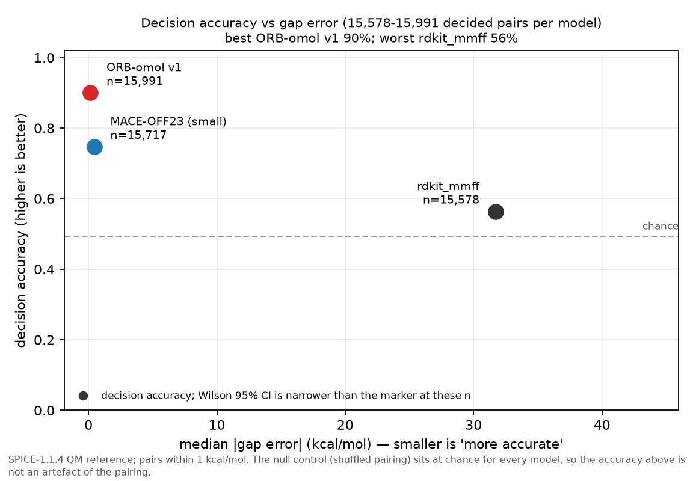

# Do machine-learned potentials preserve the chemical decisions?

**A universal MLIP can get the energy right and the chemistry wrong. This measures how often.**



Universal machine-learned interatomic potentials (uMLIPs) are ranked, in every
2026 benchmark, by energy MAE in meV/atom. Nobody downstream of those benchmarks
consumes an energy MAE. A chemist consumes a **decision**: which of these two
conformers is lower, does this reaction go forward, which tautomer wins. Those
are questions about *differences* at roughly 1 kcal/mol (43 meV) — a bar two
orders of magnitude coarser than the meV/atom numbers on the leaderboards, and a
different question from the average error.

So this repo asks the question directly. Take **16,089 conformer pairs** from the
SPICE quantum-chemistry dataset — two geometries of the *same molecule* whose
reference energies differ by **less than 1 kcal/mol** — and ask each model:
*which one is lower?* Score the sign. Compare that to the model's energy error.

## The result

| model | licence | decided pairs | **decision accuracy** (95% CI) | median \|ΔE\| error | null control p |
|---|---|---|---|---|---|
| **ORB-omol v1** | Apache-2.0 | 15,991 | **0.900** (0.895–0.905) | 0.15 kcal/mol | 0.005 |
| **MACE-OFF23 (small)** | weights ASL, code MIT | 15,717 | **0.747** (0.740–0.753) | 0.45 kcal/mol | 0.005 |
| MMFF94 (classical) | BSD | 15,578 | 0.563 (0.555–0.571) | 31.7 kcal/mol | 0.005 |

ORB-omol v1 leads at **0.900** — but it still reverses 10.0% of
near-degenerate pairs, and every model's number is checked against a shuffled-pair
control before it is quoted.

Three things worth taking from that table.

1. **A small energy error does not mean the decisions are right.** ORB-omol's
   median error is 0.15 kcal/mol — a seventh of the 1 kcal/mol bar — and it
   still reverses 10.0% of near-degenerate pairs. MACE-OFF23 sits at
   0.45 kcal/mol and reverses 25.3%.

2. **Accuracy and error size are not the same axis.** MMFF94's median error is
   206× ORB-omol's, yet it still orders 56% of pairs correctly — barely above chance,
   but far from the 0% a 32 kcal/mol error might suggest. Conversely a small error
   does not guarantee a correct ordering. That is the whole point of scoring
   decisions separately, and it is invisible on an MAE leaderboard.

3. **The biomolecular slice is harder for both ML models.** ORB-omol drops from
   0.900 to **0.855**, MACE-OFF23 from 0.747 to **0.636**, on peptides and
   solvated amino acids — the chemistry a protein engineer cares about is where
   these models are weakest. See
   [`figures/accuracy_by_subset.png`](figures/accuracy_by_subset.png).


## Why the null control matters

Every accuracy above is checked against the answer-leaking failure mode: shuffle
which model gap is paired with which quantum gap, 200 times. If a pipeline is
leaking, shuffled pairs score as well as real ones. Shuffled accuracy collapses
to chance (p = 0.005 for every model reported), which is what makes the numbers
above mean anything.


## Where the failures live

Accuracy rises with the size of the real gap: near-ties are nearly coin flips and
clear preferences are mostly right. That shape is what you would expect from a
model that resolves *some* chemistry rather than one that is guessing:


Every pair, plotted. A point on the wrong side of zero is a reversed decision;
the triangles pinned to the frame edges are the points whose model gap exceeded
the plotted range, counted rather than hidden:


## How the data is built

- **Reference:** [SPICE 1.1.4](https://zenodo.org/records/8222043) (ωB97X-D/def2-TZVP),
  19,238 molecules, ~1M conformers, downloaded and byte-verified against its
  Content-Length (16,058,156,944 bytes).
- **Pairs:** every conformer pair of a molecule whose QM energies differ by under
  1 kcal/mol, capped per molecule and selected deterministically from a seed.
  16,089 pairs from 1,588 molecules, 6,579 of them dipeptides. Each model is
  scored on the pairs it can actually evaluate (9,409–15,578 decided pairs).
- **Charges:** 404 of 1,631 molecules are ions. Formal charge and spin
  multiplicity are parsed from each molecule's SMILES rather than assumed neutral —
  running an anion as a closed-shell neutral gives a finite number that is simply
  the wrong electronic state.
- **Scoring:** all comparisons are on **differences** `E(B) − E(A)` within one
  molecule, never absolute energies. Different models use different reference
  zeros, so only differences are transferable.

## Reproducing it

```bash
python scripts/par_fetch.py <zenodo-url> SPICE-1.1.4.hdf5   # 16 GB, resumable
python scripts/spice_inventory.py --archive SPICE-1.1.4.hdf5
python scripts/build_pairs.py --archive SPICE-1.1.4.hdf5 --max-per-subset 300
python scripts/run_sweep.py --models mace_off_small orb_orbmol_v1_conservative rdkit_mmff
python scripts/score.py
python scripts/make_figures.py
pytest tests/
```

Each model runs in **its own virtualenv** (`envs/<model>/`), not out of taste:
installing `fairchem-core` upgrades `e3nn` to 0.6, which silently breaks MACE
checkpoint loading (`ValueError: too many values to unpack`) *at evaluation
time*, not at import. A shared environment produces wrong numbers, quietly.

## What went wrong on the way (kept on purpose)

The first full sweep said MACE ranked sub-kcal pairs at chance: accuracy 0.489,
ρ = −0.04, null p = 0.58. That was the pipeline, not the model — **SPICE stores
conformations in Bohr**, and they were being handed to ASE as Ångström, stretching
every molecule by 1.89×. Shortest contacts in raw coordinates were 1.85–2.08 for
C–H and N–H, which is unphysical in Å and exactly right in Bohr. With the
conversion applied and nothing else changed, accuracy went 0.489 → 0.723 and the
median error 2.93 → 0.50 kcal/mol.

The same discipline found three more: a reader that guessed the HDF5 layout wrong
(the inventory returning *zero* multi-conformer molecules is what exposed it), a
classical baseline that "succeeded" with no bonds at all in the molecule
(`SanitizeMol` on a bondless RWMol is happy to do nothing), and a licence table
that called MACE's non-commercial weights permissive after a rewording. Each has
a test or a committed note; the commit messages carry the evidence.

**A number was withdrawn here, and that is why you can trust the others.** An
earlier revision reported ORB-omol v1 at 0.893, scored from a committed artefact
holding 1,500 conformers while claiming 9,409 decided pairs — a stale file, not a
result. Recomputing every published row from its decision CSV is what caught it.
The row was withdrawn, the sweep re-run in full (15,232/15,232 conformers, zero
missing, zero NaNs), and the figure above is the re-measured one. A second
defect surfaced the same way: rounding gaps to six decimals flipped the sign of
28 near-zero MMFF pairs, so the CSV reproduced 0.5615 while the summary said
0.5633. Both are fixed, and `score.py --require-complete` now refuses to score a
model whose sweep has not finished, because a partial artefact produces a
real-looking number on a fraction of the data.

## Limits, stated plainly

- **SPICE is ωB97X-D, not CCSD(T).** At sub-kcal gaps the reference itself has
  error; a "wrong" decision within ~0.2 kcal/mol should be read as
  indistinguishable from reference noise, not as a model failure.
- **A conformer pair is a proxy for a chemical decision.** It is the cheapest
  honest proxy — same molecule, real quantum energies, thousands of examples — but
  it is not a reaction energy, a binding affinity, or a barrier. Do not quote these
  numbers as "reaction prediction accuracy".
- **The subset split is mine.** SPICE's `subset` labels are read from the archive,
  but the distinction drawn between "biomolecular" and "small molecule" is a
  grouping I chose, and the headline numbers do not depend on it.
- **Counts differ per model** because a model that fails on a conformer cannot be
  scored on pairs containing it; each row states its own n.
- **MMFF94 is not a fair fight on energy.** It is included as the classical
  reference point, and its huge error is the reason the accuracy axis matters —
  not a claim that a force field is competitive for accuracy.
- **No commercial claim.** MACE-OFF23's weights are non-commercial-only despite
  MIT code; that is recorded in every result artefact and on
  `figures/licence_table.png`.

## Layout

```
src/mlipfid/decisions.py   decision pairs, Wilson intervals, null control
src/mlipfid/spice.py       SPICE reader (Bohr -> Angstrom, charges, subsets)
src/mlipfid/select.py      energy-stratified conformer selection
scripts/run_model.py       one model, one subprocess, JSON out
scripts/run_sweep.py       chunked, resumable, per-model venv dispatch
scripts/score.py           sign agreement, error stats, null control
scripts/make_figures.py    six figures, every number read from a CSV
tests/                     32 tests: units, sign convention, null, layout
```

MIT licence for this repository's own code; the models and data keep their own
terms.
