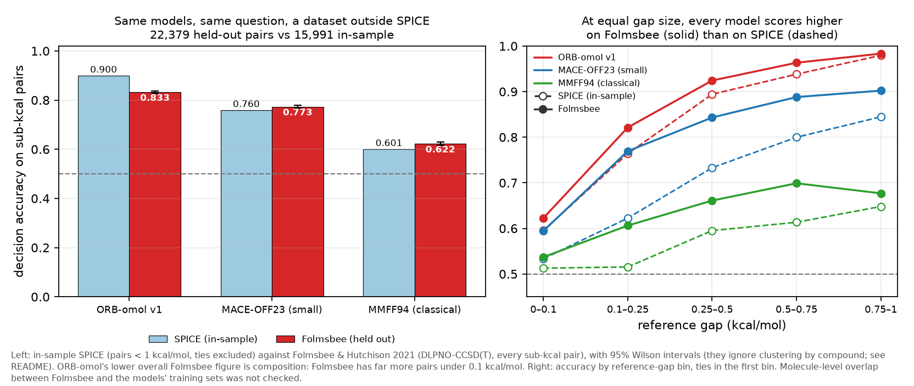
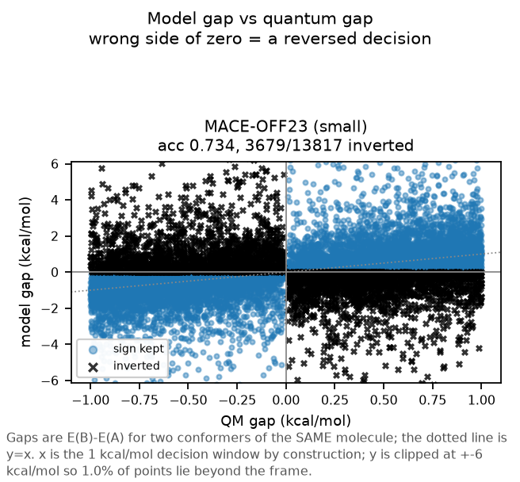

# Do machine-learned potentials preserve the chemical decisions?

[](https://github.com/Qwuantabee/mlip-fidelity/actions/workflows/tests.yml)
[](https://github.com/Qwuantabee/mlip-fidelity/blob/master/LICENSE)
[](https://github.com/Qwuantabee/mlip-fidelity/blob/master/pyproject.toml)

**Three energy models were asked, 16,089 times, which of two near-degenerate conformers is lower in energy (quantum reference gap under 1 kcal/mol). ORB-omol got 90.0% right, MACE-OFF23 76.0% and the classical MMFF94 force field 60.1%; always guessing the same way scores 53.4%. Accuracy falls as a model's pair-gap error rises (median 0.15 / 0.45 / 1.61 kcal/mol), so an energy error only means something next to the gap it has to resolve, not as a leaderboard MAE.**

**The caveat that governs those numbers: ORB-omol and MACE-OFF23 were both trained on the dataset the pairs come from (SPICE), so two of the three figures are in-sample.** On a second dataset with a higher-level reference (Folmsbee, 22,379 pairs) the ordering is the same, 0.833 / 0.773 / 0.622, but that test does not isolate how much of the in-sample figures is memorisation; see [the held-out test](#the-held-out-test-does-any-of-this-survive-outside-the-training-data).


Universal machine-learned interatomic potentials (uMLIPs) are ranked by energy MAE
in meV/atom, but a chemist consumes a **decision**: which of two conformers is
lower, which tautomer wins. That is a question about a *difference*, at roughly a
1 kcal/mol bar. The bar is not coarser than a leaderboard number: 1 kcal/mol is 43
meV per molecule, which at the median 36 atoms in this set is **1.2 meV/atom**, the
same order as the ~1 meV/atom MAEs these models advertise. So this repo asks
directly: for **16,089 pairs** of SPICE conformers of the *same molecule* whose
reference energies differ by **less than 1 kcal/mol**, which one is lower? It
scores the sign and compares that to the model's own energy error.

## The result

**Read this table as an in-sample measurement.** Two of the three models trained
on SPICE — MACE-OFF23 on ~95% of v1, ORB-omol via OMol25's documented SPICE2 — so
their rows are fidelity to their own training data, not generalisation. Only
MMFF94 is a clean row.

| model | licence | scored conformers | decided pairs | **decision accuracy** (95% CI) | median \|ΔE\| error | null control p |
|---|---|---|---|---|---|---|
| **ORB-omol v1 (conservative)** | Apache-2.0 | 15,232 | 15,991 | **0.900** (0.895–0.905) | 0.15 kcal/mol | < 0.005 |
| MACE-OFF23 (small) | weights ASL, **non-commercial**; code MIT | 14,913 | 15,717 | **0.760** (0.753–0.766) | 0.45 kcal/mol | < 0.005 |
| MMFF94 (classical force field) | BSD | 14,763 | 15,578 | 0.601 (0.594–0.609) | 1.61 kcal/mol | < 0.005 |

How to read the columns:

- **Ties are excluded, and counted.** A pair whose reference gap is within 0.01
  kcal/mol is a tie and is not scored: 98 pairs for ORB-omol and MACE-OFF23, 97
  for MMFF94. A pair containing a conformer the model could not evaluate is not
  scored either: 0 for ORB-omol, 274 for MACE-OFF23, 414 for MMFF94. "Decided
  pairs" is what is left of the 16,089. A model gap of exactly zero is *not* a
  tie: it is scored as wrong (121 ORB-omol pairs, 82 MACE-OFF23; see Limits).
- **The intervals** are Wilson intervals over pairs. Pairs from one molecule are
  not independent, so for ORB-omol and MACE-OFF23 they are about 1.4x too narrow
  (see Limits). The 1,588 molecules are the independent units.
- **The null control** shuffles which model gap goes with which quantum gap, 200
  times: accuracy collapses to 0.498–0.502 for every model and no shuffle reached
  the real one in any of the six rows. p < 0.005 is the floor 200 shuffles can
  report (1/201), not a measured value. It shows the pipeline does not leak the
  answer, not that 0.900 is right; that rests on the raw-energy recomputation in
  `scripts/check_artefacts.py` and the held-out test.
- **Run-to-run noise.** ORB-omol's GPU energies are not bit-reproducible: on the
  held-out set, where it was measured, re-running moved its accuracy by 0.001 to
  0.004 (not re-measured on SPICE). Every gap between models here is 0.14 or more,
  about forty times that. MACE-OFF23 flipped no decision across re-runs; MMFF94,
  on the CPU, was bit-identical.

All rows are recomputed from `results/decisions_*.csv` by `scripts/score.py`; a model
appears only if `scripts/verify_completeness.py` confirms its raw artefact covers
every one of the 15,232 conformers exactly once.

Four things worth taking from that table.

1. **A small average error is not a resolution guarantee.** MACE-OFF23's median
   error is 0.45 kcal/mol, and the pairs it is being asked about have a median
   true gap of only 0.55 kcal/mol (5th-95th percentile: 0.09-0.95). An error the
   size of the gap means a coin flip on the small ones, which is why it reverses
   24%.

2. **The best model is still wrong one time in ten.** ORB-omol's median error is
   0.15 kcal/mol and 0.900 accuracy means 1,596 wrong orderings out of 15,991: a
   design loop that ranks hundreds of candidates per run swaps a lot of pairs.

3. **Accuracy tracks error, and the ordering is unambiguous.** With the classical
   baseline's units corrected (see [the defect trail](docs/DEFECT_TRAIL.md)), the three models are
   monotone in *every* error measure: median gap error 0.15 / 0.45 / 1.61 kcal/mol
   gives accuracy 0.900 / 0.760 / 0.601. Pairwise differences are robust to
   clustering by molecule — on the 15,578 pairs all three models scored, with a
   bootstrap over their 1,530 molecules, ORB−MACE +0.144 [0.135, 0.152] and
   MACE−MMFF +0.160 [0.150, 0.171] (`scripts/intervals.py`) — so this is not a tie. **I do not fit a trend line:** three
   points cannot distinguish a curve from a coincidence, and an earlier draft of
   this README claimed the two were independent, which the corrected units
   refuted.

4. **The biomolecular slice is consistently harder.** Every model drops on
   peptides and solvated amino acids: ORB 0.900 → **0.855**, MACE 0.760 → **0.647**,
   MMFF94 0.601 → 0.552. See
   [`figures/accuracy_by_subset.png`](figures/accuracy_by_subset.png). Part of that
   is composition, not chemistry — see Limits.


### The baseline that makes MMFF's number honest

Pair orientation is arbitrary (whichever conformer happened to be index A), and
the QM gaps are not symmetric: **always guessing "B is higher" scores 0.534** on
these pairs. Against that constant, scored on each model's own pairs (where it
reads 0.534 for all three), the excess over guessing is ORB **+0.366**,
MACE **+0.226**, and MMFF **+0.067**.

MMFF94's edge is small but not noise: it beats the constant predictor on 4,125
pairs and loses on 3,079 (McNemar-style sign test p ≈ 6e-35), so the classical
force field carries real signal on sub-kcal orderings, an order of magnitude less
than either ML potential. An earlier version said "barely above a coin flip"
against its pre-fix 0.563; both the number and the conclusion were wrong.

## The held-out test: does any of this survive outside the training data?

Because the table above measures two models' **fidelity to their own training
data**, all three were scored on two sets from outside SPICE, on the same slice
(reference gaps under 1 kcal/mol). "Held out" means a different dataset: whether
individual Folmsbee or MPCONF196 molecules also occur in SPICE or OMol25 was not
checked.

**What this test can and cannot say, up front.** It shows the ranking of the
three models survives a change of dataset and of reference method. It does *not*
separate training-set contamination from difficulty. The only uncontaminated
model, MMFF94, is used as the difficulty control, and it is a poor one: its
accuracy barely depends on the size of the gap, while both ML models' accuracy
depends on it steeply, and Folmsbee's pairs are much closer to ties (median
reference gap 0.24 kcal/mol against SPICE's 0.55). At equal gap size all three
models, ORB-omol included, score *higher* on Folmsbee than on SPICE. No
inflation from contamination is demonstrated for either ML model.

| benchmark | compounds | sub-kcal pairs | reference |
|---|---|---|---|
| **Folmsbee & Hutchison 2021** | 690 | **22,379** | DLPNO-CCSD(T) |
| MPCONF196 (Řezáč 2018) | 7 | 30 | PNO-LCCSD(T)-F12 |

### The result



*Left: accuracy on each dataset. Right: accuracy by size of the reference gap,
SPICE dashed and Folmsbee solid (the gap-size table below).*

| model | SPICE (in-sample) | **Folmsbee held out** | shift | shift minus MMFF94's | Folmsbee, ties excluded (decided pairs) |
|---|---|---|---|---|---|
| ORB-omol v1 | 0.900 | **0.833** (0.828–0.837) | −0.068 | −0.089 | 0.840 (21,812) |
| MACE-OFF23 | 0.760 | **0.773** (0.768–0.779) | +0.013 | −0.008 | 0.780 (21,812) |
| MMFF94 | 0.601 | **0.622** (0.616–0.629) | +0.021 | — (control) | 0.624 (21,377) |

The bold column scores every sub-kcal Folmsbee pair, near-ties included, while
the SPICE column excludes ties, so the "shift" columns mix two definitions. The
last column is the like-for-like figure (567 ties excluded for the ML models, 553
for MMFF94); on that basis the shifts are −0.060 / +0.020 / +0.023. The "shift
minus MMFF94's" column is a difference of raw shifts, not a measured
contamination effect: see the gap-size table below before quoting it.

Three more parts of the held-out record are in
[`docs/HELDOUT.md`](docs/HELDOUT.md): the charge correction (74 charged Folmsbee
compounds had first been run as neutral singlets; fixing it moved ORB-omol from
0.823 to 0.833), ORB-omol's measured run-to-run noise on the GPU (about ±0.0012 on
that 0.833; MMFF94 on the CPU is bit-identical), and compound-clustered intervals,
which are wider than the Wilson intervals in the table (see Limits).

#### Accuracy at equal gap size

Decision accuracy by size of the reference gap, SPICE (in-sample) against
Folmsbee, from `scripts/reconcile_heldout.py` (block H3; ties included in the
first bin):

| reference gap (kcal/mol) | ORB-omol SPICE → Folmsbee | MACE-OFF23 SPICE → Folmsbee | MMFF94 SPICE → Folmsbee |
|---|---|---|---|
| 0 – 0.1 | 0.595 → 0.623 | 0.533 → 0.595 | 0.513 → 0.537 |
| 0.1 – 0.25 | 0.764 → 0.821 | 0.623 → 0.769 | 0.515 → 0.606 |
| 0.25 – 0.5 | 0.894 → 0.924 | 0.733 → 0.843 | 0.595 → 0.661 |
| 0.5 – 0.75 | 0.938 → 0.963 | 0.800 → 0.888 | 0.613 → 0.699 |
| 0.75 – 1.0 | 0.980 → 0.983 | 0.845 → 0.902 | 0.648 → 0.677 |

Every model is more accurate on Folmsbee in every bin. ORB-omol's lower overall
figure (0.833 against 0.900) is therefore a composition effect: 5,488 of
Folmsbee's 22,379 pairs (24.5%) have a gap under 0.1 kcal/mol, against 922 of
SPICE's 16,089 (5.7%), and those are the pairs every model gets wrong most
often. Reweighting Folmsbee's five bins to SPICE's gap distribution (ties
excluded on both sides, as in the SPICE table) gives ORB-omol 0.924, MACE-OFF23
0.851 and MMFF94 0.663, which is +0.024 / +0.091 / +0.062 against their SPICE
figures; `tests/test_readme_secondary_claims.py` recomputes it. Why Folmsbee is easier at equal gap is not
established; it differs from SPICE in at least three ways at once (relaxed minima
instead of MD snapshots, a DLPNO-CCSD(T) reference instead of the DFT level the
models were fitted near, and no ion pairs or dipeptides).

#### The "shift minus MMFF94's" column is not a contamination measurement

That column subtracts MMFF94's shift as a difficulty control. An earlier version
of this README read ORB-omol's −0.089 as "consistent with in-sample inflation".
That reading is withdrawn: MMFF94's accuracy barely depends on gap size while the
ML models' depends on it steeply, so it cannot stand in for difficulty, and once
gap size is matched the sign reverses. The intervals, the alternative
specification and the experiment that could identify an inflation effect are in
[`docs/HELDOUT.md`](docs/HELDOUT.md#the-mmff94-offset-estimate-and-why-it-is-not-a-contamination-measurement).

**MPCONF196 is withdrawn as evidence.** MACE-OFF23 scored 0.467 on its 30 sub-kcal
pairs against 0.760 in-sample, but the pairs come from 7 compounds, 26 of them
from three linear tripeptides, and a compound-clustered interval is [0.14, 0.71].
The number is kept, labelled, with the full account in
[`docs/HELDOUT.md`](docs/HELDOUT.md#mpconf196-the-withdrawn-result).

### What this leaves standing

On 22,379 sub-kcal pairs from a dataset outside SPICE, **ORB-omol still orders near-degenerate conformers at 0.833 against MMFF94's
0.622** — an ML potential does beat a force field outside SPICE, by about 21
points on Folmsbee's own mix of gap sizes against 30 in-sample. Most of that
difference is the gap mix rather than the dataset: at SPICE's gap distribution
the Folmsbee margin is 26 points. That the ranking ORB > MACE > MMFF94 holds on
both datasets is the defensible claim. How much of either ML model's in-sample
accuracy is memorisation is not measured here.

## Where the failures live

Accuracy rises with the size of the true gap: near-ties are close to coin flips
and clear preferences are mostly right, the shape of a model resolving *some*
chemistry rather than guessing:


Every pair, plotted; a point on the wrong side of zero is a reversed decision, and
the triangles on the frame edges are model gaps beyond the plotted range:




## How the data is built

Every conformer pair of a [SPICE 1.1.4](https://zenodo.org/records/8222043)
molecule whose reference energies differ by under 1 kcal/mol, capped per molecule
and selected from a seed: **16,089 pairs from 1,588 molecules**. Charges come from
each SMILES, and only within-molecule energy differences are scored. Sources,
counts and the charge handling: [`docs/DATA.md`](docs/DATA.md).

## Reproducing it

The two `--max-*-per-molecule 12` flags are **not optional**: they are the values
the committed manifest was built with, and a reviewer found that omitting them
yields 12,242 pairs instead of 16,089 while every later step silently succeeds.

```bash
python scripts/par_fetch.py <zenodo-url> SPICE-1.1.4.hdf5   # 16 GB, resumable
python scripts/spice_inventory.py --archive SPICE-1.1.4.hdf5
python scripts/build_pairs.py --archive SPICE-1.1.4.hdf5 --max-per-subset 300 \
    --max-pairs-per-molecule 12 --max-conformers-per-molecule 12
bash scripts/sweep_all.sh                                   # one launcher, one GPU
python scripts/verify_completeness.py --write               # gate: artefact coverage
python scripts/score.py --require-complete
python scripts/make_figures.py
pytest tests/
```

Each model runs in **its own virtualenv** (`envs/<model>/`): installing
`fairchem-core` upgrades `e3nn` to 0.6, which breaks MACE checkpoint loading *at
evaluation time*, not at import, so a shared environment gives wrong numbers quietly.

**The held-out half** (Folmsbee, MPCONF196, the repeatability run and every
bootstrap interval) has its own commands, with the upstream commits the artefacts
were built from, in [`docs/HELDOUT.md`](docs/HELDOUT.md#reproducing-the-held-out-half).
Without a GPU, the committed energies re-derive every Folmsbee artefact byte for
byte.

**Expected runtime:** the 16 GB SPICE download dominates (hours on one
connection). The three SPICE model runs took 433 s (ORB-omol), 319 s (MACE-OFF23)
and 18 s (MMFF94) on one GPU (`wall_seconds` in `results/raw_*.json`). The
held-out builders take about 15 s, every no-GPU recompute under 20 s, and
`pytest` about 20 s.

## What went wrong on the way (kept on purpose)

Six defects changed or withdrew a published number or broke a guard on one: a
Bohr/Ångström unit bug, an ORB-omol row scored from a partial artefact, a chunk
cache keyed by index, failure counts summed from truncated lists, MMFF94 energies
stored in the wrong unit, and a hand-edited completeness gate. Each has a
regression test in `tests/`; the account, with the numbers each one changed, is in
[`docs/DEFECT_TRAIL.md`](docs/DEFECT_TRAIL.md).

## Limits, stated plainly

Each limit below is set out with its measurement in [`docs/LIMITS.md`](docs/LIMITS.md).

- **Two of the three rows are in-sample** (MACE-OFF23 trained on ~95% of SPICE v1;
  ORB-omol's OMol25 includes SPICE2). The held-out test shows the ranking survives
  outside SPICE; it does not measure the size of any in-sample inflation.
- **The reference is DFT (ωB97M-D3(BJ)), not CCSD(T)**: a wrong decision within
  ~0.2 kcal/mol is indistinguishable from reference noise.
- **Not every pair is a conformer pair:** 3,149 of 16,089 pairs (19.6%) come from
  DES370K dimers and 21 ion-pair diatomics, where both ML models return exact-zero
  gaps (a cutoff effect) and ORB scores 0.126.
- **The geometries are MD snapshots, not relaxed minima**, and the "biomolecular"
  slice is 99.6% dipeptides.
- **Pairs cluster by molecule.** The design effect is about 2 (ICC about 0.10), so
  the ORB and MACE intervals should be about 1.4x wider than quoted
  (`scripts/intervals.py`); the held-out Wilson intervals are worse off (design
  effect 3.5–5.4), with compound-clustered intervals in `docs/HELDOUT.md`. No
  conclusion changes, but the CIs as printed are optimistic.
- **MACE-OFF23 has no charge input**: 3,241 of its 15,717 decided pairs involve a
  charged conformer, and it scores **0.623 there against 0.796 on neutral pairs**
  (its own training domain: 0.796 on 12,476 pairs). It returns NaN on 319
  conformers whose elements it does not support.
- **A conformer pair is a proxy for a chemical decision**, not a reaction energy,
  binding affinity or barrier; three models are not a model zoo.
- **No commercial claim.** MACE-OFF23's weights are non-commercial (Academic
  Software Licence); see [`NOTICE`](NOTICE).

## Layout

Code in `src/mlipfid/` (decision pairs and intervals, the SPICE reader, conformer
selection), the pipeline in `scripts/`, tests in `tests/`, and the long-form detail
in `docs/`; a file-by-file map is in [`docs/LAYOUT.md`](docs/LAYOUT.md).

MIT licence for this repository's own code. The models and data keep their own
terms: see [`NOTICE`](NOTICE) for each model and dataset, and the licence figure
above.

## References and prior art

Full citations (SPICE, MACE-OFF23, OMol25, RDKit MMFF94) are in
[`docs/REFERENCES.md`](docs/REFERENCES.md). The framing is not new: Matbench
Discovery (Riebesell et al.) argues for materials that a low MAE does not mean a
model is useful, and conformer-ranking benchmarks (Folmsbee, MPCONF196,
TorsionNet206) exist for molecules. **This repo's contribution is the measurement
on SPICE conformer pairs, and the disclosure that two of its three models are
trained on the test data.**

## Part of a set

Six repos, one method: take the number a field reports, measure what a practitioner uses, publish
the gap.

- [admet-split-truth](https://github.com/Qwuantabee/admet-split-truth): does a validation split predict error on the next compounds?
- mlip-fidelity: do ML potentials rank near-degenerate conformers correctly?
- [epistasis-ceiling](https://github.com/Qwuantabee/epistasis-ceiling): do single-mutant effects add up on a double mutant?
- [variant-effect-prediction](https://github.com/Qwuantabee/variant-effect-prediction): does a cleaner assay target help zero-shot ESM-2?
- [single-cell-de](https://github.com/Qwuantabee/single-cell-de): are cells replicates?
- [enzyme-kinetics](https://github.com/Qwuantabee/enzyme-kinetics): how wrong is a Lineweaver-Burk Km?

Overview: https://github.com/Qwuantabee
