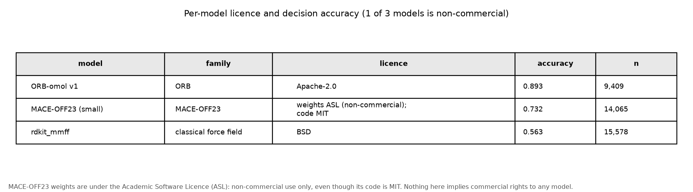

# Do machine-learned potentials preserve the chemical decisions?

**On sub-kcal/mol conformer pairs, sign accuracy is a steep and predictable function of pair-gap error: a median error of 0.15 kcal/mol gets 90% of orderings right, 0.45 gets 75%, and 1.35 gets 56%. Error does predict the decision — but only if you compare it to the gap you are trying to resolve, not to a leaderboard MAE.**


Universal machine-learned interatomic potentials (uMLIPs) are ranked, in every
2026 benchmark, by energy MAE in meV/atom. Nobody downstream of those benchmarks
consumes an energy MAE. A chemist consumes a **decision**: which of these two
conformers is lower, does this reaction go forward, which tautomer wins. Those are
questions about *differences*, at roughly a 1 kcal/mol bar.

That bar is **not** orders of magnitude coarser than a leaderboard number — it is
the same size, because the two are different quantities. 1 kcal/mol is 43 meV per
molecule, which at the median 36 atoms in this set is **1.2 meV/atom**: the same
order as the ~1 meV/atom MAEs these models advertise. The point is not that the
bar is coarser; it is that an average error and a resolution threshold are not
interchangeable, and only one of them tells you whether two candidates swap.

So this repo asks it directly. Take **16,089 conformer pairs** from the SPICE
quantum-chemistry dataset — two geometries of the *same molecule* whose reference
energies differ by **less than 1 kcal/mol** — and ask each model: *which one is
lower?* Score the sign. Compare that to the model's own energy error.

## The result

| model | licence | scored conformers | decided pairs | **decision accuracy** (95% CI) | median \|ΔE\| error | null control p |
|---|---|---|---|---|---|---|
| **ORB-omol v1 (conservative)** | Apache-2.0 | 15,232 | 15,991 | **0.900** (0.895–0.905) | 0.15 kcal/mol | 0.005 |
| MACE-OFF23 (small) | weights ASL, **non-commercial**; code MIT | 14,913 | 15,717 | **0.747** (0.740–0.753) | 0.45 kcal/mol | 0.005 |
| MMFF94 (classical force field) | BSD | 14,763 | 15,578 | 0.563 (0.555–0.571) | 1.35 kcal/mol | 0.005 |

All three rows are recomputed from the committed `results/decisions_*.csv` by
`scripts/score.py`, and a model only appears here if
`scripts/verify_completeness.py` confirms its raw artefact covers every one of the
15,232 conformers exactly once.

Four things worth taking from that table.

1. **A small average error is not a resolution guarantee.** MACE-OFF23's median
   error is 0.45 kcal/mol, and the pairs it is being asked about have a median
   true gap of only 0.55 kcal/mol (5th-95th percentile: 0.09-0.95). An error the
   size of the gap means a coin flip on the small ones, which is why it reverses
   25%.

2. **The best model is still wrong one time in ten.** ORB-omol's median error is
   0.15 kcal/mol and 0.900 accuracy means 1,596 wrong orderings out of 15,991. If
   your design loop ranks hundreds of candidates per run, that is a lot of
   swapped pairs.

3. **Accuracy tracks error, and the ordering is unambiguous.** With the classical
   baseline's units corrected (see "What went wrong"), the three models are
   monotone in *every* error measure: median gap error 0.15 / 0.45 / 1.35 kcal/mol
   gives accuracy 0.900 / 0.747 / 0.563. Pairwise differences are robust to
   clustering by molecule — ORB−MACE +0.157 [0.149, 0.166], MACE−MMFF +0.185
   [0.174, 0.197] — so this is not a tie. **I do not fit a trend line:** three
   points cannot distinguish a curve from a coincidence, and an earlier draft of
   this README claimed the two were independent, which the corrected units
   refuted.

4. **The biomolecular slice is consistently harder.** Every model drops on
   peptides and solvated amino acids: ORB 0.900 → **0.855**, MACE 0.747 → **0.636**,
   MMFF94 0.563 → 0.552. See
   [`figures/accuracy_by_subset.png`](figures/accuracy_by_subset.png). Part of that
   is composition, not chemistry — see Limits.


## Why the null control matters

Every accuracy above is checked against the answer-leaking failure mode: shuffle
which model gap is paired with which quantum gap, 200 times, and rescore. If the
pipeline were leaking, shuffled pairs would score as well as real ones. Shuffled
accuracy collapses to ~0.49 for every model (p = 0.005 in all six rows), which is
what makes the real numbers mean anything. The null is not an optional extra — it
is the only reason to believe a 0.900.


## Where the failures live

Accuracy rises with the size of the true gap: near-ties are close to coin flips
and clear preferences are mostly right. That shape is what a model resolving
*some* chemistry looks like, as opposed to one that is guessing:


Every pair, plotted. A point on the wrong side of zero is a reversed decision.
The triangles pinned to the frame edges are points whose model gap exceeded the
plotted range — counted rather than hidden:




## How the data is built

- **Reference:** [SPICE 1.1.4](https://zenodo.org/records/8222043)
  (ωB97M-D3(BJ)/def2-TZVPPD), 19,238 molecules. Downloaded and byte-verified against its
  Content-Length (16,058,156,944 bytes).
- **Pairs:** every conformer pair of a molecule whose QM energies differ by under
  1 kcal/mol, capped per molecule and selected deterministically from a seed:
  **16,089 pairs from 1,588 molecules**, 6,607 of them biomolecular (6,579
  dipeptides). Each model is scored on the pairs it can actually evaluate.
- **Charges:** 404 molecules are ions. Formal charge and spin multiplicity are
  parsed from each molecule's SMILES rather than assumed neutral — running an
  anion as a closed-shell neutral returns a finite number for the wrong
  electronic state.
- **Scoring:** every comparison is on the **difference** `E(B) − E(A)` within one
  molecule, never absolute energies. Models use different reference zeros (ORB and
  MACE both sit near −28,000 eV on these molecules), so only differences are
  transferable.

## Reproducing it

```bash
python scripts/par_fetch.py <zenodo-url> SPICE-1.1.4.hdf5   # 16 GB, resumable
python scripts/spice_inventory.py --archive SPICE-1.1.4.hdf5
python scripts/build_pairs.py --archive SPICE-1.1.4.hdf5 --max-per-subset 300
python scripts/sweep_all.sh                                 # one launcher, one GPU
python scripts/verify_completeness.py --write               # gate: artefact coverage
python scripts/score.py --require-complete
python scripts/make_figures.py
pytest tests/
```

Each model runs in **its own virtualenv** (`envs/<model>/`), not out of taste:
installing `fairchem-core` upgrades `e3nn` to 0.6, which silently breaks MACE
checkpoint loading (`ValueError: too many values to unpack`) *at evaluation time*,
not at import. A shared environment produces wrong numbers, quietly.

## What went wrong on the way (kept on purpose)

This section exists because a repo that only shows its successes teaches the
reader nothing about how far to trust it.

**1. A unit bug that made the first result meaningless.** The first full sweep said
MACE ranked sub-kcal pairs at chance: accuracy 0.489, null p = 0.58. The pipeline
was wrong, not the model — **SPICE stores conformations in Bohr**, and they were
being handed to ASE as Ångström, stretching every molecule by 1.89×. With the
conversion applied and nothing else changed, accuracy went 0.489 → 0.723.

**2. A withdrawn number.** An earlier revision of this README reported ORB-omol v1
at 0.893. That row had been scored from an artefact holding 1,500 conformers
while claiming 9,409 decided pairs. It was withdrawn rather than patched, and has
now been re-measured in full: the complete sweep gives **0.900 on 15,991 decided
pairs**, from an artefact that covers all 15,232 conformers. The pre-fix number
and the post-fix number are close, which is luck, not vindication — the first one
was not reproducible and should never have been published.

**3. A chunk cache that silently corrupted every result.** Chunk files were named
by chunk *index*. Two sweeps with different `--chunk` sizes — one launched by a
stale wrapper script that bypassed the shell-level lock — wrote into the same
slots, so a 600-conformer chunk was resumed as if it were a 1,500-conformer slice.
Merged artefacts reported `ok` while holding **1,200 duplicated and 6,232 missing
conformers**, and every published accuracy was computed from that. Three fixes,
each with a test that failed first: chunk cache keys now encode the *slice*, a
cached chunk is refused unless its ids match the requested slice exactly, and the
lock moved from the wrapper into `run_sweep.py` itself so no launcher can bypass
it.

**4. A failure count that under-reported missing data by 4.5×.** Per-chunk failure
lists are truncated to 10 entries for payload size; the merge summed those
truncated lengths, so a run with 319 NaN conformers reported `n_failed=70`. Each
chunk now carries its own true count.

**5. A completeness gate that was a hand-edited claim.** `sweep_complete.json` was
written by hand, which let a model be marked complete while its artefact was
partial. It is now recomputed from the raw artefacts by
`scripts/verify_completeness.py`, and `score.py --require-complete` will emit no
rows at all rather than quietly partial ones.

Earlier finds are also recorded with tests: an HDF5 reader that guessed the layout
wrong (the inventory returning *zero* multi-conformer molecules is what exposed
it), a classical baseline that "succeeded" with no bonds at all in the molecule,
a silent neutral-charge fallback, and a licence table that called MACE's
non-commercial weights permissive after a rewording.

## Limits, stated plainly

- **SPICE is ωB97M-D3(BJ), not CCSD(T).** At sub-kcal gaps the reference itself carries
  error; a "wrong" decision within ~0.2 kcal/mol should be read as
  indistinguishable from reference noise, not as a model failure.
- **Two of the three rows are train/test contaminated, and I only found out after
  publishing.** This is the single biggest caveat in the table and a reviewer had
  to point it out:
  - **MACE-OFF23** is trained on ~95% of SPICE v1 (MACE-OFF paper, arXiv 2312.15211,
    Sec. II.2), so scoring it on SPICE 1.1.4 is mostly an **in-sample** evaluation.
    Its 0.747 is an in-sample number that is still only 0.747.
  - **ORB-omol** is trained on OMol25, whose community domain documents SPICE2 — a
    superset of SPICE 1.x. So it is also very likely in-sample at the molecule
    level; geometry-level overlap I cannot verify.
  - **MMFF94** is the only clean out-of-sample row.
  - Read the ML accuracies as *fidelity to their own training data*, not as
    generalisation. A held-out test on an independent conformer benchmark
    (Folmsbee, MPCONF196, TorsionNet206) is the missing experiment.
- **Not every pair is a conformer pair, and the wording above overstates it.**
  3,149 of 16,089 pairs (19.6%) come from multi-component systems: the DES370K
  subset is hydrogen-bonded **dimers** (`C=C.[Na+]`), so those pairs are
  intermolecular geometry changes, and the 21 ion-pair molecules are diatomics
  scanned over 2.5-7.4 Å. The ion-pair row is a mechanical failure, not a chemistry
  failure — all three models return exact-zero gaps beyond ~6 Å, consistent with a
  graph cutoff — and ORB scores 0.126 there. Excluding those two subsets changes
  every headline number and is the first thing a follow-up should do.
- **A conformer pair is a proxy for a chemical decision.** It is the cheapest
  honest proxy — same molecule, real quantum energies, thousands of examples — but
  it is not a reaction energy, a binding affinity, or a barrier. Do not quote these
  numbers as "reaction prediction accuracy".
- **Three models is not a model zoo.** No trend line is fitted, no ranking beyond
  these three is implied, and the "energy error does not predict decisions"
  headline is a statement about these three, not a law.
- **Counts differ per model** because a conformer a model cannot evaluate cannot
  be scored in any pair containing it; each row states its own n. MACE-OFF23
  returned NaN on 319 of 15,232 conformers (2.1%). I originally wrote "almost all
  charged or radical species"; that was wrong. Checked: **every one of the 319
  contains an element MACE-OFF23 does not support** (Li 43, Na 135, K 154, Mg 3,
  Ca 20), and none is merely charged.
- **MACE-OFF23 shows float32 precision loss on these molecules.** Its absolute
  energies sit near −28,000 eV, where float32 resolution is ~0.045 kcal/mol; 441
  scored pairs (2.8% of decided ones) have a model gap of *exactly* zero and are
  counted as wrong. Excluding them moves MACE 0.747 → 0.768, so the headline
  number is the conservative one.
- **The subset split is mine.** SPICE's `subset` labels are read from the archive,
  but the biomolecular / small-molecule grouping is a choice I made; the headline
  numbers do not depend on it.
- **MMFF94 is not a fair fight on energy.** It is the classical reference point,
  and its huge error is why the accuracy axis matters — not a claim that a force
  field is competitive.
- **No commercial claim.** MACE-OFF23's **weights are non-commercial only** (an
  Academic Software Licence) even though its code is MIT; ORB-omol's package
  metadata declares Apache-2.0; RDKit/MMFF94 is BSD. Per-model terms are in every
  result artefact and on [`figures/licence_table.png`](figures/licence_table.png).
  Nothing here implies commercial use of an ASL model.

## Layout

```
src/mlipfid/decisions.py       decision pairs, Wilson intervals, null control
src/mlipfid/spice.py           SPICE reader (Bohr -> Angstrom, charges, subsets)
src/mlipfid/select.py          energy-stratified conformer selection
scripts/run_model.py           one model, one subprocess, JSON out
scripts/run_sweep.py           chunked, resumable, per-model venv dispatch, locked
scripts/verify_completeness.py recomputes which models cover every conformer
scripts/score.py               sign agreement, error stats, null control
scripts/make_figures.py        six figures, every number read from a CSV
tests/                         tests: units, sign convention, null, layout, cache
```

MIT licence for this repository's own code. The models and data keep their own
terms — see the licence column and the figure above.
